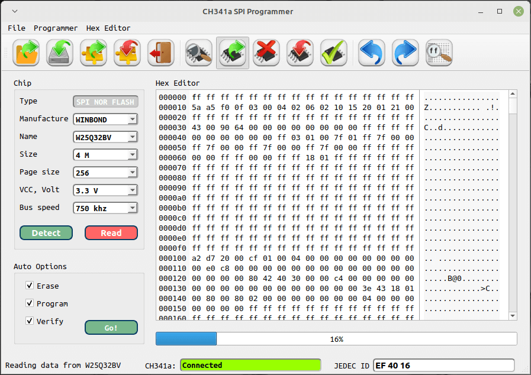

# CH341PROG

A modern Qt5 GUI programmer for **CH341A** USB SPI NOR flash devices, forked from
[`bigbigmdm/CH341a_spi_programmer`](https://github.com/bigbigmdm/CH341a_spi_programmer)
(based on QHexEdit2 and the ch341prog tools).

Reads, writes, erases and verifies SPI NOR flash (25xxx series), with automatic
JEDEC chip detection, pin/contact diagnostics and adapter / voltage checking.

## Features

- **Auto chip detection** – reads the JEDEC ID (majority vote over several reads) and
  matches it against an EZP-compatible chip database.
- **Pin / contact diagnostics** – distinguishes *no response (FF FF FF)*, *data line
  stuck low (00 00 00)*, *marginal/unstable contact* and *USB error*, with advice.
- **Chip families** – a Family selector covering the CH341A families (SPI NOR 25xxx,
  25/24/93/95/45 series) with per-family counts; filters the manufacturer/name lists.
- **Adapter / voltage panel** – select the adapter in use (3.3 V direct, 1.8 V / 2.5 V /
  1.2 V level adapters, SOIC-8/16 clips, DIP-8 socket, WSON-8) and see a live description
  of what it does. **Detect adapter / voltage** checks the chip response and compares the
  selected adapter voltage with the chip's VCC from the database, warning when e.g. a
  1.8 V part is used without the 1.8 V adapter.
- **Modern UI** – sidebar navigation, dashboard with live stat cards, light & dark
  themes, toast notifications and a live console.
- **Chip Info tab** – full chip details (JEDEC ID, manufacturer, name, family, type,
  size, page size, VCC, algorithm, erase delay, EEPROM pages), the **programmer firmware
  revision**, a per-signal connection status (CS# / CLK / MOSI / MISO / VCC / GND) and a
  drawn **SOIC-8 / SOP-8 pinout diagram** with each pin coloured by its inferred state.
- **Tools** – blank check, fill buffer, status-register read / unprotect, SFDP read-out,
  compare with file, go-to-address, export region, copy buffer.
- **Non-blocking operations** – erase runs asynchronously (bounded, with progress); long
  reads/writes/verifies keep the UI responsive.
- **Hex editor** – QHexEdit with find/replace, undo/redo, save/load whole image or region.



> **Note:** this firmware/driver implements the CH341A **SPI** protocol, so it programs
> SPI NOR flash (25xxx). The other families (24xxx I²C, 93xxx Microwire, 95xx, 45xx) are
> listed for catalogue/filtering but are not programmed by this build.

## Building on Linux

```sh
sudo apt install cmake qtbase5-dev libusb-1.0-0-dev
mkdir build && cd build
cmake ..
make -j4
sudo make install      # installs to /opt/CH341SPI, adds a menu entry + udev rule
```

Run it from the menu, or `cd /opt/CH341SPI && ./CH341SPI`. The app loads `CH341a.Dat`
from its working directory (it also looks in its own folder and `/opt/CH341SPI`).

### Linux notes

- The CH341A's in-kernel `spi-ch341` driver must not claim the device. Blocking it is
  recommended:
  ```
  /etc/modprobe.d/99-ch341.conf:   blacklist spi_ch341
                                   install spi_ch341 /bin/true
  ```
  plus a udev rule to unbind it if it still loads (see `other/99-CH341.rules`).
- On Wayland the app runs via XWayland automatically so modal dialogs work.

## Building on Windows

Windows builds are produced by GitHub Actions (`.github/workflows/windows.yml`) using
MSYS2 (MINGW64) with Qt5 and libusb. Every push builds **`CH341PROG.exe`**, bundles the
Qt/libusb runtime with `windeployqt`, and uploads `CH341PROG-windows.zip` as an artifact
and to a GitHub release — unzip and run `CH341PROG.exe`.

To build locally on Windows with MSYS2:
```sh
pacman -S mingw-w64-x86_64-gcc mingw-w64-x86_64-cmake mingw-w64-x86_64-qt5 mingw-w64-x86_64-libusb
cmake -S . -B build_win -G "MinGW Makefiles" -DCMAKE_PREFIX_PATH=/mingw64
cmake --build build_win --parallel
```
(on Windows you also need the WinUSB/libusb driver bound to the CH341A — use Zadig).

## License

GPL-3.0 — see [LICENSE](LICENSE). Original work © the ch341prog / CH341a_spi_programmer
authors.
